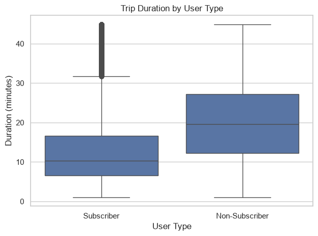
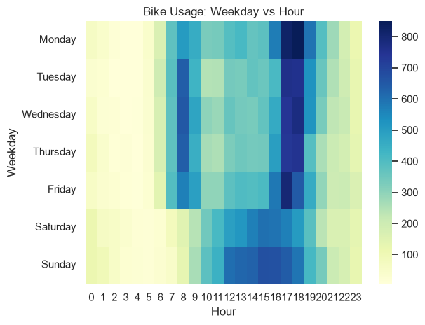

# Citi Bike: чем различается поведение подписчиков и обычных клиентов

Исследовательский анализ 50 000 поездок Citi Bike (Нью-Йорк, сентябрь 2013). Основной вопрос: **от чего зависит продолжительность поездки и как она связана с типом пользователя и временем суток.**

## Главный вывод

**Длительность поездки определяется типом подписки, а не временем суток.**

- Медианная поездка не-подписчика длится **19,6 мин**, подписчика — **10,4 мин** (почти вдвое дольше; Mann–Whitney, p < 0,001; в 73% случаев случайная поездка не-подписчика длиннее).
- Между сегментами дня медиана колеблется всего на **1,7 мин** (10,1–11,8 мин), а разрыв между группами сохраняется в любое время суток.
- Время суток определяет не длительность, а **объём спроса**: в будни 29% поездок приходится на три часа (8, 17 и 18 ч).

Подписчики (86% поездок) ездят короткими поездками по рабочему графику, не-подписчики (14%) — вдвое дольше, днём и в выходные. Это две разные модели использования, которым нужны разные решения.



## Ключевые находки

| # | Вопрос | Результат |
|---|---|---|
| 1 | Когда спрос максимален? | В будни два пика: 8 ч (143 поездки в день) и 17–18 ч (около 180 в день). В выходные пика утром нет, спрос держится на плато с 12 до 17 ч. Будни в среднем 1 723 поездки в день, выходные 1 536 (−11%, p = 0,005). |
| 2 | Как меняется длительность? | От типа подписки: 19,6 против 10,4 мин. От времени суток почти не зависит (разброс 1,7 мин). В выходные поездки на 2 мин длиннее (12,7 против 10,8), но это в основном эффект состава: в выходные доля не-подписчиков выше (48% их поездок против 24% у подписчиков). |
| 3 | Какие маршруты долгие? | Самые долгие по медиане (32–40 мин) — круговые поездки у Central Park, начало и конец в одной станции. Круговых поездок у не-подписчиков в 3,8 раза больше (6,8% против 1,8%). |
| 4 | Различается ли время начала поездок? | Да (χ², p ≈ 0). В 7–9 ч у подписчиков 17,9% поездок, у не-подписчиков 6,1%. У не-подписчиков пик сглажен и приходится на 12–14 ч. |
| 5 | Отличаются ли самые загруженные станции? | Топ-10 станций (3% всех) дают 8,9% стартов. Профиль поездок почти тот же: медиана 10,7 против 11,3 мин. Станции отличаются нагрузкой, а не поведением. |
| 6 | Подписчики и обычные клиенты | Подписчики: 86% поездок, 10,4 мин, 24% в выходные. Не-подписчики: 14% поездок, 19,6 мин, 48% в выходные. |
| 7 | Динамика по дням | Медианная длительность дня сильнее всего связана с долей подписчиков (r = −0,95), а не с числом поездок (r = −0,63). День «длиннее», когда в нём больше не-подписчиков. |



## Что из этого следует

1. **Доступность велосипедов в 8 и 17–18 часов в будни — приоритет.** Три часа дают почти треть будничного спроса, и это в основном подписчики.
2. **Не-подписчикам нужен отдельный подход.** Они занимают велосипед вдвое дольше, ездят днём и в выходные, часто по кругу. Тарифы с поминутной оплатой или пакеты на час и день подойдут им лучше.
3. **Для прогнозирования занятости нужно смотреть на состав пользователей, а не только на час и день недели.** Состав объясняет динамику лучше, чем объём.
4. **Самым загруженным станциям нужен запас ёмкости, а не особые правила.** Их поведенческий профиль не отличается от остальных.

## Данные

- Источник: выгрузка поездок Citi Bike за сентябрь 2013 года, 50 000 строк, 18 столбцов (`citibike.csv`).
- Описание столбцов: [Data Dictionary](./%23%20Data%20Dictionary%20%23U2014%20Citi%20Bike%20Trips%20Data.md).
- Пропуски только в `birth_year` (13,96%): они совпадают с не-подписчиками, у которых возраст и пол не указаны.

## Методы

- Очистка: проверка дат, дубликатов, длительности, возраста, согласованности `trip_duration` и разницы `end_time − start_time` (у 1 019 строк расхождение больше секунды, строки оставлены и отмечены как ограничение).
- Признаки: час, день недели, сегмент времени суток, длительность в минутах, расстояние по формуле Haversine, возраст.
- Сравнение групп: среднее и медиана (длительность скошена вправо), доли внутри групп, а не абсолютные числа.
- Проверки: тест Манна — Уитни, критерий χ², бутстрэп-интервал для разницы медиан, корреляции по дням.
- Маршруты сравниваются при ≥10 поездок (123 из 27 667 маршрутов), чтобы единичные поездки не искажали результат.

## Ограничения

- Один месяц (сентябрь 2013): сезонность и долгосрочные тренды не оцениваются. Выходных дней всего 9.
- Длительность в датасете обрезана на 45 мин, поэтому реальный разрыв между группами, вероятно, больше.
- Возраст и пол не используются как независимые сегменты: у не-подписчиков они не заполнены, и эти срезы дублируют тип подписки.
- Корреляция и различия между группами описывают поведение, но не доказывают причины. Связь доли подписчиков и числа поездок по дням не позволяет разделить их влияние.
- Выводы по маршрутам опираются на узкий срез (около 3% поездок).

## Структура репозитория

```
.
├── citibike.csv                              # данные
├── citibike_jupiter_notebook.ipynb           # анализ
├── # Data Dictionary — Citi Bike Trips Data.md
├── 01_trip_duration_distibution_.png
├── 02_trip_duration_by_usertype.png
├── 03_trips_by_hour_of_day.png
├── 04_trips_by_day_of_week.png
├── 05_tripsusing_duration_by_hour_weekday.png
└── README.md
```

## Как запустить

```bash
pip install pandas numpy matplotlib seaborn scipy jupyter
jupyter notebook citibike_jupiter_notebook.ipynb
```

В ноутбуке задайте путь к данным относительным: `DATA_PATH = "citibike.csv"`.

## Инструменты

Python, pandas, NumPy, SciPy, Matplotlib, Seaborn, Jupyter.

## Что можно сделать дальше

- Добавить данные за несколько месяцев и проверить сезонность.
- Посчитать баланс прибытий и отправлений по станциям (где не хватает велосипедов).
- Построить интерактивный дашборд для сравнения сегментов.
